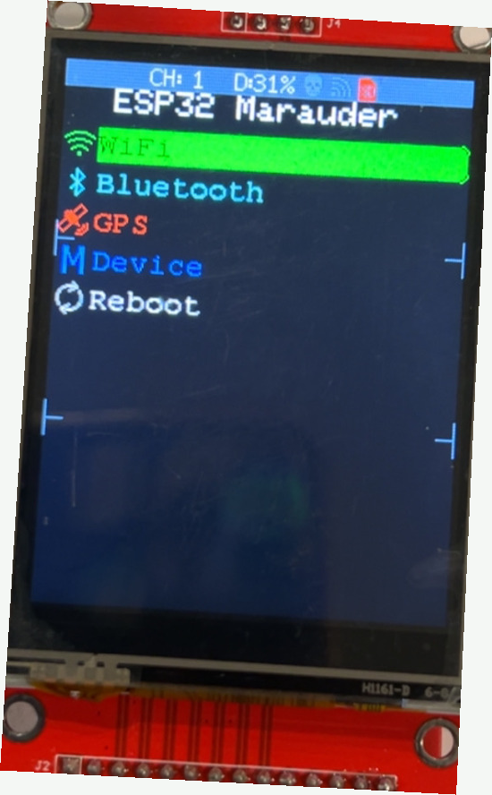
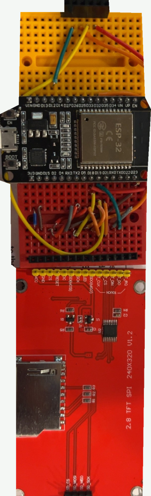

# ESP32 Marauder WPA2 Security Capstone

Washington State University · CptS 432 · 2025

I built an ESP32-based wireless security prototype, diagnosed a microSD mount failure, and validated WPA2 authentication evidence in an instructor-authorized WSU lab.

[Portfolio presentation (PDF)](presentation/ESP32-Marauder-WPA2-Security-Capstone.pdf) · [Editable PowerPoint](presentation/ESP32-Marauder-WPA2-Security-Capstone.pptx) · [Technical case study](docs/technical-case-study.md)

 

### Video Demonstration

[▶ Watch my ESP32 Marauder WPA2 Capstone Demonstration](https://youtu.be/2y4-D3z_nvg)

Recorded walkthrough of my authorized WSU capstone, including the ESP32 hardware, troubleshooting, wireless traffic analysis, and lab results.

## Project evidence

| Evidence | What it shows |
| --- | --- |
| [Running TFT](assets/assembled-tft.png) and [rear assembly](assets/assembled-rear.png) | The completed prototype, including the ESP32, TFT, breadboard wiring, and microSD module. |
| [microSD mount error](assets/storage-error.png) | The original serial error recorded during functional testing. My final report records a successful mount after I inspected and reworked the header solder joints. |
| [Wireshark EAPOL exchange](assets/wireshark-eapol.png) | Four EAPOL Key messages, labeled 1 through 4, from the same lab exchange. I used Wireshark to check capture completeness after earlier captures showed only two or three messages. |
| [First Hashcat run](assets/hashcat-exhausted.png) and [later Hashcat run](assets/hashcat-recovered.png) | The original output excerpts show **Exhausted, 0/1 recovered**, followed by **Cracked, 1/1 recovered** in the later assessment. |
| [Lab findings](docs/lab-findings.md) and [presentation brief](docs/presentation-brief.md) | The project outcomes and what can be concluded from one authorized lab configuration. |

The photographs have been cropped to remove surrounding paperwork. The output excerpts preserve the relevant packet labels and tool results while omitting addresses, authentication data, credentials, and local paths.

## What I did and learned

- Assembled and soldered the hardware, flashed the Marauder firmware with esptool, and used PuTTY to verify serial connectivity.
- Used hardware inspection and functional testing to isolate the microSD fault. A working display and console helped narrow the issue to the storage path.
- Checked the quality of the packet evidence before interpreting the offline assessment. The initial result applied to the candidates evaluated. The later result demonstrated that the authorized lab passphrase was guessable.
- Documented both outcomes and their scope. The same habits apply to entry-level SOC work such as validating telemetry, triaging alerts, and writing investigation notes.

## Credits and references

- [ESP32 Marauder firmware](https://github.com/justcallmekoko/ESP32Marauder) was developed by Just Call Me Koko and the project's contributors. I assembled and tested my own prototype using their firmware.
- [Wireshark's EAPOL reference](https://www.wireshark.org/docs/dfref/e/eapol.html) documents the protocol fields available in the packet analyzer.
- [Hashcat](https://hashcat.net/hashcat/) is the third-party tool used to record the two lab assessment outcomes.
