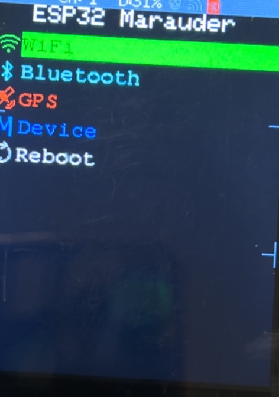
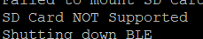

# Technical case study

## Scope

I built an ESP32-based WPA2 security prototype for my Washington State University capstone. The lab was instructor-authorized. I used the firmware boot and serial output to validate basic operation, then examined wireless authentication evidence and documented the result.

## Prototype and fault isolation

The prototype combined an ESP32, a display, and microSD storage. I soldered the hardware, flashed the firmware, and verified that the device booted and responded over serial.

One functional test recorded a microSD mount failure. I inspected the storage connections, and my final report records a successful card mount after solder rework at the header. A working display and serial console established that the device booted while the storage path still needed investigation.

## Wireless evidence

Early captures contained only part of the WPA2 authentication exchange. Later lab work produced a complete exchange. The first offline password assessment produced no match, while a later assessment recovered the lab passphrase. The first result was limited to the candidates tested. The later result demonstrated the risk of a guessable passphrase in this specific lab.

## SOC relevance

I practiced checking whether evidence was complete before interpreting it, tracing a failure across hardware and software, and documenting the limits of my conclusions. These are the same habits I would bring to alert triage and incident documentation.

The findings are based on my capstone records and cover one lab configuration.
